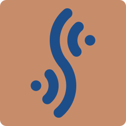
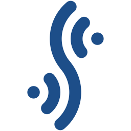
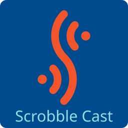
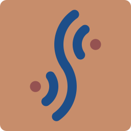
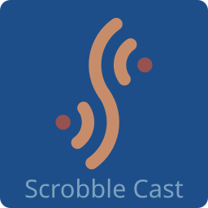
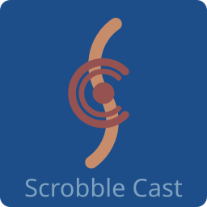

# Scrobble Cast Logo

These were originally created in 2014, updated in 2017, and redrawn in 2026. Lovingly crafted in SVG.

## 2026

Two colours, no name inside. Its values are explored in [study.html](study.html) (open it in a browser).

The icon has no tile, for small sizes (the favicon): one colour, Classic Blue, Sandstone in dark mode.

## 2017

## 2014 Originals

Names: no suffix, the logo on its tile; `-name`, the name inside the tile; `-icon`, the bare mark on a transparent background.
